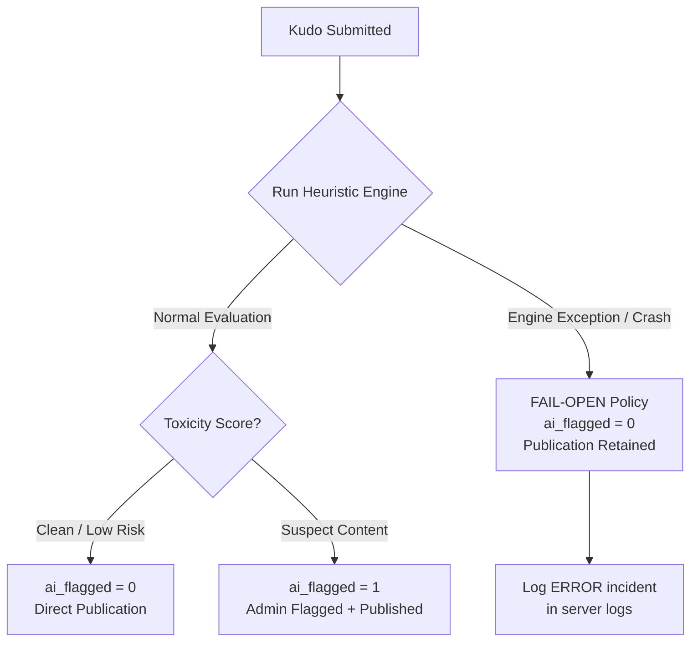

# Technical and Functional Specification: Datacom Kudos System

**Project:** Datacom Internal Employee Recognition Portal  
**Document Identifier:** SPEC-DATACOM-KUDOS-001  
**Version:** 1.0.0 (Final Approved Technical and Functional Specification)  
**Repository:** [https://github.com/clairedata/datacomkudos](https://github.com/clairedata/datacomkudos)  
**Author:** Tahiri My Ahmed (`clairedata`)  


---

## 1. Context, Requirements Origin, and Scope

### 1.1 Requirements Origin and Traceability

To maintain strict methodological discipline following *Spec-Driven Development*, all system requirements are categorized by source to differentiate the official assessment brief, original specifications, gaps identified during audit, and senior architectural recommendations:

| Identifier | Source | Summary Description |
| :--- | :--- | :--- |
| **REQ-SUJET-01** | `TASK2_INSTRUCTIONS.md` (L.26) | User selection from an active colleagues list/dropdown. |
| **REQ-SUJET-02** | `TASK2_INSTRUCTIONS.md` (L.26, 100) | Composition of a short appreciation message (max 500 characters). |
| **REQ-SUJET-03** | `TASK2_INSTRUCTIONS.md` (L.101) | Secure submission and relational persistence of the kudo in the database. |
| **REQ-SUJET-04** | `TASK2_INSTRUCTIONS.md` (L.27, 102) | Chronological public feed on the main dashboard displaying recent kudos. |
| **REQ-SUJET-05** | `TASK2_INSTRUCTIONS.md` (L.37, 103) | Administrator content moderation: ability to hide or delete inappropriate messages. |
| **REQ-SUJET-06** | `TASK2_INSTRUCTIONS.md` (L.44-45) | Schema update for `kudos` table: adding `is_visible` (default: true), `moderated_by`, `moderated_at`, `reason_for_moderation`. |
| **REQ-SUJET-07** | `TASK2_INSTRUCTIONS.md` (L.38, 69) | Edge cases handling: spam, duplicate submissions, inappropriate content, input validation. |
| **REQ-SPEC-01** | `SPECIFICATION.md v1.0` | User roles (`user`, `admin`), quick praise chips (*"👏 Bravo!"*, *"⭐ Great work!"*, etc.). |
| **REQ-SPEC-02** | `SPECIFICATION.md v1.0` | Automated AI-assisted pre-moderation (*Human-in-the-Loop*). |
| **REQ-GAP-01** | Security Audit | **Mock Identity Switcher vs. Real Authentication Clarification**: `X-User-Id` header is a local evaluation testbed mock, not a secure production protocol. RBAC permissions are strictly enforced server-side. |
| **REQ-GAP-02** | Security Audit | **Strict Public Data Isolation**: Complete separation between `PublicKudoDTO` (internal moderation metadata expunged) and `AdminKudoDTO`. |
| **REQ-GAP-03** | Data Integrity Audit | **Reconciliation of REQ-SUJET-06 and Immutability**: Preserves brief-mandated columns on `kudos` for current state, augmented by an immutable `moderation_audit_logs` table protected by SQL triggers. |
| **REQ-GAP-04** | Functional Audit | **Formalized AI Flag Dismissal**: Dedicated endpoint to reject false-positive AI flags (`DISMISS_AI_FLAG`) via an atomic transaction. |
| **REQ-REC-01** | Senior Recommendation | Standardized RFC 7807 error format, structured logging policy, cache justification, and documented Fail-Open resilience policy. |

---

### 1.2 Scope Definition: Pedagogical Prototype vs. Enterprise Target System

| Dimension | Pedagogical Prototype (Datacom Evaluation) | Enterprise Target System (Datacom Production) |
| :--- | :--- | :--- |
| **Application Host** | Standalone Python (FastAPI / Uvicorn) service hosting a static SPA. | Micro-frontend or Web Component embedded in Datacom's intranet portal. |
| **Authentication** | **Mock Profile Switcher (Evaluation Testbed)**: `X-User-Id` header injected by frontend. Strictly for local evaluation. | Microsoft Entra ID (Azure AD) via OpenID Connect (OIDC) / signed Bearer JWT validated against JWKS endpoints. |
| **Database** | Self-contained **SQLite** relational database (`data/kudos.db` via Python standard library `sqlite3`). | Managed **PostgreSQL** or Azure SQL with connection pooling and versioned migrations. |
| **AI Engine** | Synchronous local heuristic analyzer (bad-words lexicon, harassment patterns, and spam heuristics). | Dedicated asynchronous microservice powered by a language model (Azure Content Safety / LLM). |
| **Deployment** | Single public Git repository, local execution via `uv run python src/main.py`. | Docker multi-stage containerization, automated CI/CD pipeline, Kubernetes / Azure Container Apps hosting. |

---

## 2. Functional Requirements and Business Rules

### 2.1 Personas, Roles, and Server-Side Access Control (RBAC)

> [!IMPORTANT]
> **Security Notice & Architecture Clarification:**  
> The `X-User-Id` header mechanism utilized in this prototype is an **educational evaluation mock** designed to test the application and demonstrate role-switching without deploying full enterprise SSO infrastructure.  
> **This mechanism does NOT represent secure production authentication**, as an adversary on an open network could forge this header.  
> However, **all authorizations, business rules, and role checks are strictly executed on the server side**. The client cannot grant itself elevated privileges: the server resolves the user identity against the SQLite database, extracts their official role, and rejects unauthorized actions with `HTTP 403 Forbidden`.

Two strict roles are enforced by server-side middleware:

| Business Capability | Standard Employee (`user`) | Administrator / Moderator (`admin`) |
| :--- | :---: | :---: |
| Browse directory of active colleagues | Yes | Yes |
| Send a kudo to an active colleague | Yes | Yes |
| View public feed of visible kudos (`is_visible = 1`) | Yes | Yes |
| View hidden kudos (`is_visible = 0`) | No (`403 Forbidden` / SQL filtering) | Yes |
| View AI alerts and flag reasons (`ai_flagged`) | No (Expunged from public DTOs) | Yes |
| Hide a kudo with mandatory reason | No | Yes |
| Restore visibility of a hidden kudo | No | Yes |
| Permanently delete a kudo | No | Yes |
| Dismiss an AI alert (false positive) | No | Yes |
| View moderation audit history logs | No | Yes |

---

### 2.2 User Stories

* **US-01 [Recipient Selection]:** As an employee, I want to select an active colleague from a rich dropdown (name, department, avatar) so that I direct my appreciation to the correct person.
* **US-02 [Composition & Quick Praise]:** As an employee, I want to write a message (3 to 500 characters) or click quick praise chips (*"👏 Bravo!"*, *"⭐ Great work!"*, *"🤝 Thanks for your help!"*, *"🚀 Awesome delivery!"*) to easily express my gratitude.
* **US-03 [Submission & Validation]:** As an employee, I want to submit my kudo and receive immediate feedback, with the assurance that integrity rules are strictly validated by the server.
* **US-04 [Public Feed]:** As an employee, I want to view a chronological public feed of recent kudos on the dashboard in reverse chronological order (newest first).
* **US-05 [Admin Manual Moderation]:** As an administrator, I want to hide or delete an inappropriate kudo, with mandatory entry of a moderation reason to ensure full auditability.
* **US-06 [AI Pre-Moderation & Quarantine]:** As an administrator, I want suspicious messages containing offensive or inappropriate content to be automatically placed in quarantine upon submission (hidden from the recipient and public feed) so that I can review and approve or delete them prior to delivery.
* **US-07 [AI False Positive Dismissal]:** As an administrator, I want to dismiss an unfounded AI flag to restore normal status in the audit trail.

---

### 2.3 Explicit Business Rules

* **BR-01 (Self-Kudos Prohibition):** A user cannot send kudos to themselves (`sender_id != recipient_id`). Validation occurs client-side (UI alert/prevention) and is strictly enforced server-side (`HTTP 422 Unprocessable Entity`).
* **BR-02 (User Status Validation):** Kudos can only be addressed to active employees (`is_active = 1`). Submissions to inactive accounts are rejected (`HTTP 422`).
* **BR-03 (Closed Categories List):** The category must strictly belong to the following closed enumeration:  
  `['Teamwork', 'Innovation', 'Customer Delight', 'Leadership', 'Above & Beyond']`. Any other value is rejected (`HTTP 422`).
* **BR-04 (Message Length & Sanitization):** The message must contain between 3 and 500 characters after trimming whitespace (`trim()`). HTML entities are sanitized/escaped to neutralize XSS vectors.
* **BR-05 (Anti-Spam & Duplicate Prevention):**
  - A minimum cooldown of 10 seconds is enforced between successive kudos from the same sender (`HTTP 429`).
  - Submitting an identical message to the same recipient within a 5-minute window is blocked (`HTTP 429 - Duplicate Submission`).
* **BR-06 (Public Data Isolation & DTOs):**
  - For standard user requests (`role === 'user'`), SQL queries strictly enforce `WHERE is_visible = 1`.
  - The server returns exclusively `PublicKudoDTO`. Internal fields (`is_visible`, `moderated_by`, `moderated_at`, `reason_for_moderation`, `ai_flagged`, `ai_flag_reason`) are **strictly expunged** from the JSON payload.
* **BR-07 (Reconciliation of Current State and Audit Logs):**
  - To fulfill `REQ-SUJET-06`, the `kudos` table maintains current moderation state columns: `is_visible`, `moderated_by`, `moderated_at`, `reason_for_moderation`.
  - To satisfy enterprise immutability and compliance, every moderation event (hide, restore, delete, dismiss AI flag) writes an immutable record to `moderation_audit_logs`.
* **BR-08 (Atomic Moderation Transactions):** Every moderation action must execute inside an atomic SQL transaction (`BEGIN TRANSACTION ... COMMIT`). If logging fails, the state change on `kudos` is immediately rolled back.
* **BR-09 (Audit Retention After Deletion):** When a kudo is permanently deleted (`DELETE /api/v1/kudos/:id`), the row in `kudos` is removed, but its `kudo_id` and complete history remain preserved in `moderation_audit_logs`. The foreign key constraint has **no** destructive `ON DELETE CASCADE`.
* **BR-10 (Immutability of Audit Logs):** Records in `moderation_audit_logs` are append-only. SQL database triggers explicitly abort any attempt to `UPDATE` or `DELETE` records in this table.
* **BR-11 (AI Content Moderation, Automated Quarantine & Fail-Open Resilience):**
  - **Pre-Moderation Quarantine:** Content analysis runs synchronously upon submission. If the heuristic engine flags a message (e.g., abusive terms, harassment, spam repetition), the kudo is persisted with `is_visible = 0` (quarantined) and an automated moderation reason. The message is completely inaccessible to standard users (including the recipient) until reviewed and approved by an administrator.
  - **Instant Publication for Clean Messages:** Messages with zero flags are published immediately (`is_visible = 1`).
  - **Fail-Open Resilience Policy:** In the event of an unhandled internal exception within the heuristic analyzer, the system applies a **Fail-Open** policy: the kudo is accepted and published (`ai_flagged = 0, is_visible = 1`), while an `ERROR` log is recorded on the server for investigation.

---

## 3. Data Architecture and Relational Schema

### 3.1 Technology Selection: Relational SQLite (`sqlite3`)

For the pedagogical prototype scope, **SQLite** via Python's standard library `sqlite3` is selected.  
*Justification:* Built into Python standard library with zero external native compilation requirements, cross-platform stability on Windows, synchronous high performance, zero external server infrastructure required by assessors, native support for ACID transactions, foreign keys, `CHECK` constraints, and SQL triggers.

---

### 3.2 Complete SQL DDL Schema

```sql
-- 1. Enable foreign key constraint enforcement in SQLite
PRAGMA foreign_keys = ON;

-- 2. Users table (Datacom employees)
CREATE TABLE IF NOT EXISTS users (
    id TEXT PRIMARY KEY,
    name TEXT NOT NULL,
    email TEXT NOT NULL UNIQUE,
    role TEXT NOT NULL DEFAULT 'user' CHECK(role IN ('user', 'admin')),
    avatar TEXT NOT NULL,
    department TEXT NOT NULL,
    is_active INTEGER NOT NULL DEFAULT 1 CHECK(is_active IN (0, 1)),
    created_at TEXT NOT NULL DEFAULT (datetime('now'))
);

-- 3. Kudos table (Reconciliation with REQ-SUJET-06: current state columns)
CREATE TABLE IF NOT EXISTS kudos (
    id TEXT PRIMARY KEY,
    sender_id TEXT NOT NULL,
    recipient_id TEXT NOT NULL,
    category TEXT NOT NULL CHECK(category IN ('Teamwork', 'Innovation', 'Customer Delight', 'Leadership', 'Above & Beyond')),
    message TEXT NOT NULL CHECK(length(trim(message)) >= 3 AND length(message) <= 500),
    is_visible INTEGER NOT NULL DEFAULT 1 CHECK(is_visible IN (0, 1)),
    moderated_by TEXT,
    moderated_at TEXT,
    reason_for_moderation TEXT,
    ai_flagged INTEGER NOT NULL DEFAULT 0 CHECK(ai_flagged IN (0, 1)),
    ai_flag_reason TEXT,
    created_at TEXT NOT NULL DEFAULT (datetime('now')),
    updated_at TEXT NOT NULL DEFAULT (datetime('now')),
    FOREIGN KEY (sender_id) REFERENCES users(id) ON DELETE RESTRICT,
    FOREIGN KEY (recipient_id) REFERENCES users(id) ON DELETE RESTRICT,
    FOREIGN KEY (moderated_by) REFERENCES users(id) ON DELETE SET NULL,
    CHECK (sender_id != recipient_id)
);

-- 4. Moderation Audit Logs table (Immutable audit history)
CREATE TABLE IF NOT EXISTS moderation_audit_logs (
    id TEXT PRIMARY KEY,
    kudo_id TEXT NOT NULL,
    moderator_id TEXT NOT NULL,
    action TEXT NOT NULL CHECK(action IN ('HIDE', 'RESTORE', 'DELETE', 'DISMISS_AI_FLAG')),
    reason TEXT NOT NULL,
    previous_visibility INTEGER CHECK(previous_visibility IN (0, 1)),
    new_visibility INTEGER CHECK(new_visibility IN (0, 1)),
    created_at TEXT NOT NULL DEFAULT (datetime('now')),
    FOREIGN KEY (moderator_id) REFERENCES users(id) ON DELETE RESTRICT
);

-- 5. SQL Triggers enforcing audit log immutability (Append-only)
CREATE TRIGGER IF NOT EXISTS trg_prevent_audit_update
BEFORE UPDATE ON moderation_audit_logs
BEGIN
    SELECT RAISE(ABORT, 'Security Violation: Moderation audit log records are immutable and cannot be modified.');
END;

CREATE TRIGGER IF NOT EXISTS trg_prevent_audit_delete
BEFORE DELETE ON moderation_audit_logs
BEGIN
    SELECT RAISE(ABORT, 'Security Violation: Moderation audit log records are immutable and cannot be deleted.');
END;

-- 6. Performance indexes
CREATE INDEX IF NOT EXISTS idx_kudos_feed ON kudos(is_visible, created_at DESC);
CREATE INDEX IF NOT EXISTS idx_kudos_recipient ON kudos(recipient_id);
CREATE INDEX IF NOT EXISTS idx_kudos_ai_flagged ON kudos(ai_flagged);
CREATE INDEX IF NOT EXISTS idx_audit_kudo ON moderation_audit_logs(kudo_id);
```

---

## 4. API Contracts Specification (REST / JSON)

### 4.1 Standardized Error Format (RFC 7807)

All error responses adhere to the following standard payload:

```json
{
  "error": {
    "code": "VALIDATION_ERROR",
    "message": "The submission contains invalid fields.",
    "status": 422,
    "details": [
      { "field": "recipient_id", "issue": "An employee cannot send a kudo to themselves." }
    ],
    "timestamp": "2026-10-12T14:30:00Z"
  }
}
```

Standardized application error codes:
- `BAD_REQUEST` (400): Malformed JSON body or invalid syntax.
- `UNAUTHORIZED` (401): Missing or invalid `X-User-Id` header.
- `FORBIDDEN` (403): Insufficient permissions (admin required or inactive account).
- `NOT_FOUND` (404): Requested resource not found.
- `VALIDATION_ERROR` (422): Business rule violated (length, self-kudos, inactive user).
- `RATE_LIMIT_EXCEEDED` (429): Cooldown violated or duplicate submission within 5 min.
- `INTERNAL_SERVER_ERROR` (500): Unhandled server exception.

---

### 4.2 Authentication Middleware & Session Context

1. **Extraction:** The `authMiddleware` reads the `X-User-Id` header from the request.
2. **Database Lookup:** If the ID is missing or not found in `users`, `401 Unauthorized` is returned immediately.
3. **Active Check:** If `user.is_active !== 1`, `403 Forbidden` (`ACCOUNT_INACTIVE`) is returned.
4. **Context Attachment:** The sanitized user object is attached to `req.currentUser`.
5. **Sender Integrity:** In `POST /api/v1/kudos`, `sender_id` is **always derived from `req.currentUser.id`**. Any client-supplied `sender_id` in `req.body` is discarded.
6. **RBAC Enforcement:** The `requireAdmin` middleware checks `req.currentUser.role === 'admin'`. Non-admins receive `403 Forbidden`.

---

### 4.3 DTOs (Data Transfer Objects) & Endpoints Contracts

#### 1. `GET /api/v1/users`
* **Access:** Any authenticated user (`user` or `admin`).
* **Description:** Lists active colleagues for the recipient dropdown.
* **Response `200 OK`:**
  ```json
  [
    {
      "id": "u-01",
      "name": "Sarah Connor",
      "email": "sarah.c@datacom.com",
      "department": "Cloud Solutions",
      "avatar": "https://api.dicebear.com/7.x/avataaars/svg?seed=Sarah"
    }
  ]
  ```

---

#### 2. `GET /api/v1/kudos`
* **Access:** Any authenticated user.
* **Query Parameters:**
  - `limit` (integer, 1 to 50, default: 20)
  - `offset` (integer >= 0, default: 0)
  - `filter` (admin only: `'all'` | `'flagged'` | `'hidden'`, default: `'all'`)
* **Strict Role-Based DTO Separation (BR-06):**

##### Example Response `200 OK` for Standard User (`PublicKudoDTO`):
*Internal moderation fields and AI flags are completely expunged.*
```json
{
  "data": [
    {
      "id": "k-101",
      "category": "Teamwork",
      "message": "Thanks for your tremendous help resolving the network incident this morning!",
      "created_at": "2026-10-12T13:45:00Z",
      "sender": { "id": "u-01", "name": "Sarah Connor", "avatar": "..." },
      "recipient": { "id": "u-02", "name": "James Vance", "avatar": "..." }
    }
  ],
  "pagination": { "total": 42, "limit": 20, "offset": 0, "has_more": true }
}
```

##### Example Response `200 OK` for Administrator (`AdminKudoDTO`):
*Includes moderation and audit metadata for administrative oversight.*
```json
{
  "data": [
    {
      "id": "k-101",
      "category": "Teamwork",
      "message": "Thanks for your tremendous help resolving the network incident this morning!",
      "created_at": "2026-10-12T13:45:00Z",
      "sender": { "id": "u-01", "name": "Sarah Connor", "avatar": "..." },
      "recipient": { "id": "u-02", "name": "James Vance", "avatar": "..." },
      "is_visible": true,
      "moderated_by": null,
      "moderated_at": null,
      "reason_for_moderation": null,
      "ai_flagged": true,
      "ai_flag_reason": "Alert: Potential suspect keywords detected"
    }
  ],
  "pagination": { "total": 42, "limit": 20, "offset": 0, "has_more": true }
}
```

---

#### 3. `POST /api/v1/kudos`
* **Access:** Any active user.
* **Request Body:**
  ```json
  {
    "recipient_id": "u-02",
    "category": "Innovation",
    "message": "Outstanding work on the automated CI/CD deployment pipeline!"
  }
  ```
* **HTTP Status Codes:**
  - `201 Created`: Kudo created and returned.
  - `400 Bad Request`: Missing or invalid JSON body.
  - `401 Unauthorized`: Unrecognized session.
  - `422 Unprocessable Entity`: Business rule violations (BR-01, BR-02, BR-03, BR-04).
  - `429 Too Many Requests`: Anti-spam violation (BR-05).

---

#### 4. `PATCH /api/v1/kudos/:id/moderate`
* **Access:** Administrator only (`requireAdmin`).
* **Request Body:**
  ```json
  {
    "is_visible": false,
    "reason": "Content violates company professional conduct guidelines"
  }
  ```
* **Transactional Behavior:**
  1. Checks kudo existence (`404` if not found).
  2. SQL Transaction: Updates `is_visible`, `moderated_by = req.currentUser.id`, `moderated_at = datetime('now')`, `reason_for_moderation = reason`.
  3. Inserts audit log entry into `moderation_audit_logs`.
* **HTTP Status Codes:** `200 OK`, `400 Bad Request`, `403 Forbidden`, `404 Not Found`.

---

#### 5. `POST /api/v1/kudos/:id/dismiss-flag`
* **Access:** Administrator only (`requireAdmin`).
* **Description:** Dismisses an unfounded AI alert (false positive).
* **Request Body:**
  ```json
  {
    "reason": "Verified false positive: technical term used in proper work context"
  }
  ```
* **Transactional Behavior:**
  1. SQL Transaction: Updates `ai_flagged = 0`, `ai_flag_reason = NULL`.
  2. Inserts audit entry into `moderation_audit_logs` with `action = 'DISMISS_AI_FLAG'`.
* **HTTP Status Codes:** `200 OK`, `403 Forbidden`, `404 Not Found`.

---

#### 6. `DELETE /api/v1/kudos/:id`
* **Access:** Administrator only (`requireAdmin`).
* **Request Body:**
  ```json
  {
    "reason": "Severe spam content requiring permanent deletion"
  }
  ```
* **Transactional Behavior:**
  1. Retrieves kudo snapshot before deletion.
  2. Inserts final audit entry into `moderation_audit_logs` (`action = 'DELETE'`).
  3. Permanently deletes record from `kudos`.
* **HTTP Status Codes:** `200 OK` (`{ "success": true, "message": "Kudo deleted and logged to audit trail." }`), `403 Forbidden`, `404 Not Found`.

---

#### 7. `GET /api/v1/kudos/:id/audit`
* **Access:** Administrator only (`requireAdmin`).
* **Description:** Full chronological audit history for a specific kudo.
* **HTTP Status Codes:** `200 OK`, `403 Forbidden`.

---

## 5. Automated AI Pre-Moderation and Detection Engine

### 5.1 Heuristic Nature & Technical Scope

> [!NOTE]
> **Deterministic Local Heuristics:**  
> In this self-contained pedagogical prototype, the AI detection engine is implemented as a **local heuristic analyzer**. It requires no paid external LLM APIs, ensuring the project executes 100% offline and cost-free for Datacom assessors.

The analyzer applies a sequential detection pipeline:
1. **Lexical Normalization:** Lowercasing, diacritic/accent removal, and leetspeak character conversion (e.g., mapping `1` to `i`, `@` to `a`).
2. **Offensive Pattern Matching:** Category-based exclusion dictionary (discriminatory language, direct slurs, hostile aggression).
3. **Spam & Flooding Heuristics:** Repetitive character patterns (e.g., `aaaaaaa`), external unauthorized hyperlinks.

---

### 5.2 Resilience Policy & Fail-Open Analysis

The system enforces a **Fail-Open** resilience policy:



#### Documented Consequences of the Fail-Open Policy:
* **Advantages:** High service availability. No positive employee recognition is blocked due to software faults in the heuristic engine.
* **Identified Risks:** During an engine crash, an inappropriate message could be published without an automated alert flag.
* **Mitigating Safeguards:**
  1. Server immediately records an `ERROR` level log with incident context for monitoring.
  2. Administrators retain the ability to manually hide (`PATCH /moderate`) or delete (`DELETE`) messages at any time.

---

## 6. Frontend Architecture, UX, and Accessibility

### 6.1 Component Hierarchy

```
AppContainer
├── NavigationBar
│   ├── BrandIdentity ("Datacom Kudos Portal")
│   ├── MockIdentitySwitcher (Switch: Alice [Employee] <-> Thomas [Admin])
│   └── CurrentUserBadge
├── MainLayout (Responsive layout)
│   ├── KudosCreationPanel
│   │   ├── RecipientDropdown (Searchable, avatar, department)
│   │   ├── CategorySelector (Interactive radio badges)
│   │   ├── QuickPraiseChips (Pre-filled chips: Bravo, Great work, Thanks, Delivery)
│   │   ├── MessageTextarea (Dynamic character counter 0/500, visual validation)
│   │   └── SubmitButton (Disabled / loading / celebratory trigger)
│   └── KudosFeedPanel
│       ├── FeedHeader (Admin filters: All /  AI Flagged /  Hidden)
│       ├── FeedContainer
│       │   ├── LoadingSkeleton
│       │   ├── EmptyFeedState
│       │   ├── ErrorRetryBanner
│       │   └── KudosCardList
│       │       └── KudosCardItem
│       │           ├── CardHeader (Sender -> Recipient, Relative timestamp)
│       │           ├── CardBody (Category badge, Message body)
│       │           ├── AIFlagAlert (Admin-only warning badge)
│       │           └── AdminToolbar (Buttons: Hide, Restore, Dismiss flag, Delete)
└── ModerationModal (Accessible dialog for mandatory reason entry)
```

### 6.2 Digital Accessibility (WCAG 2.1 Level AA)

* **Full Keyboard Navigation:** All interactive elements can be reached via `Tab` with an accessible focus indicator (`outline: 2px solid #0056b3`).
* **Color Contrast:** Contrast ratios meet or exceed 4.5:1 across all body and UI text.
* **ARIA Attributes & Live Regions:**
  - Real-time announcements of additions and updates via `aria-live="polite"`.
  - Moderation modal uses `role="dialog"`, `aria-modal="true"`, and traps keyboard focus.
  - Form controls include `aria-describedby` linked to character counters and validation messages.

### 6.3 Responsive Design (Breakpoints)

* **Mobile (< 640px):** Single vertical column. Compact collapsible form, horizontal scrolling praise chips.
* **Tablet (640px - 1023px):** Fluid layout with balanced spacing.
* **Desktop (>= 1024px):** 2-column grid layout: Form fixed on the left, chronological feed scrolling on the right.

---

## 7. Logging, Caching Strategy, and Security

### 7.1 Structured Logging Strategy

The application outputs structured timestamps to `stdout` / `stderr`:  
`[TIMESTAMP] [LEVEL] [CORRELATION-ID] [ROUTE] - MESSAGE`

Log Levels:
* `INFO`: Server startup, kudo submission, moderation action executed.
* `WARN`: Self-kudo attempt, anti-spam triggered, AI heuristic flag raised.
* `ERROR`: SQL transaction failure, unhandled exception, heuristic engine fault.
* **Security Rule:** Sensitive information (tokens, passwords, internal stack traces) is never sent in HTTP client responses.

---

### 7.2 HTTP Caching Strategy

* **Architectural Justification:** An external cache layer (like Redis) is omitted from this prototype to prevent cache invalidation stale states during live moderation and to maintain zero external dependencies for evaluators.
* **HTTP Headers Applied:**
  - Dynamic API routes (`/api/v1/*`): `Cache-Control: no-store, no-cache, must-revalidate` (ensures instant feed freshness and up-to-date moderation states).
  - Static assets (`/css/*`, `/js/*`, avatars): `Cache-Control: public, max-age=86400` (24h browser cache).

---

## 8. Requirements Traceability Matrix (RTM)

| Requirement | Acceptance Criterion (AC) | Test Type | Validation Test Case |
| :--- | :--- | :--- | :--- |
| **REQ-SUJET-01** | Active colleagues list rendered with avatars and departments. | API Integration | `GET /api/v1/users` returns non-empty array with `is_active = 1`. |
| **REQ-SUJET-02** | Message accepted between 3 and 500 characters; chips functional. | Unit Validation | Rejects <3 and >500 character messages (`HTTP 422`). |
| **REQ-SUJET-03** | Relational persistence verified in SQLite. | DB Integration | Row inserted into SQLite `kudos` with valid foreign keys. |
| **REQ-SUJET-04** | Public feed sorted descending (`created_at DESC`). | API Integration | Verify reverse-chronological order of returned records. |
| **REQ-SUJET-05** | Hide and delete restricted to admins with mandatory reason. | Security / RBAC | Standard user calling `PATCH /moderate` receives `403 Forbidden`. |
| **REQ-SUJET-06** | Moderation columns present on `kudos` (`is_visible`, `moderated_by`, etc.). | DB Schema | Verify presence and update of state columns in `kudos`. |
| **REQ-SUJET-07** | Spam and duplicate prevention. | API Functional | Identical submission within 5 min returns `429 Too Many Requests`. |
| **BR-01** | Strict self-kudos prohibition (`sender_id != recipient_id`). | Unit & API | Submitting with sender == recipient returns `422 Unprocessable Entity`. |
| **BR-06** | Strict public data isolation (`PublicKudoDTO`). | Security / Leak | `GET /api/v1/kudos` as `user` returns no moderation or internal fields. |
| **BR-08 / BR-10**| Audit log immutability and trigger enforcement. | SQL Integrity | Direct `UPDATE` or `DELETE` on `moderation_audit_logs` fails via trigger. |
| **US-07** | Administrator dismisses AI alert. | Admin Functional | `POST /dismiss-flag` sets `ai_flagged = 0` and logs audit entry. |
| **BR-11** | Fail-Open AI resilience. | Robustness | Simulate heuristic exception: kudo publishes normally with `ai_flagged = 0`. |

---

## 9. Phased Implementation Plan and Exit Criteria (DoD)

| Phase | Phase Name | Prerequisites | Concrete Deliverables | Verifiable Exit Criteria (Definition of Done) |
| :---: | :--- | :--- | :--- | :--- |
| **P1** | **Initialization & SQLite Database Layer** | Approved Specification. | `pyproject.toml`, `src/db/schema.sql`, `src/db/database.py`, `src/db/seeds.py`. | Database `kudos.db` initialized, foreign keys enforced, audit triggers active, 6 Datacom employees seeded. |
| **P2** | **Backend Core & Heuristic AI Engine** | Phase P1 completed. | `src/services/ai_moderation.py`, `src/services/kudos_service.py`. | Business rules (self-kudos, 500 chars, categories, AI detection, Fail-Open) passing 20 unit tests. |
| **P3** | **REST API, RBAC Security & DTOs** | Phase P2 completed. | `src/middleware/auth.py`, `src/api/routes.py`, `src/main.py`. | All endpoints operational with precise HTTP status codes, RFC 7807 errors, and strict `PublicKudoDTO` isolation. |
| **P4** | **Interactive UI & Submission Form** | Phase P3 completed. | `static/index.html`, `static/css/style.css`, `static/js/app.js`. | Responsive form, working praise chips, live character counter, full accessibility states. |
| **P5** | **Public Feed & Admin Moderation Queue** | Phase P4 completed. | `static/index.html`, `static/css/style.css`, `static/js/app.js`. | Mock profile switcher, feed filtering, automated quarantine triage, modal moderation with mandatory reasons. |
| **P6** | **Global Verification & RTM Test Suite** | Phase P5 completed. | `tests/test_services.py`, `tests/test_api.py`. | 100% of test cases passing (38/38 tests green across security, integrity, and moderation). |
| **P7** | **Git Versioning & Final Delivery** | Phase P6 completed. | Clean Git repository, atomic commits, operational `README.md`. | Ready to push to GitHub with `SPECIFICATION.md` at root. |

---

## 10. Deployment and Configuration

### 10.1 Environment Configuration (`.env` / Defaults)
* `PORT=8000` (HTTP listening port)
* `DB_PATH=./data/kudos.db` (SQLite database file location)

### 10.2 Local Prototype Execution (Compliant with Datacom Rubric)
1. Initialize & Install Dependencies: `uv sync`
2. Initialize Database & Seeds: `uv run python -m src.db.database`
3. Execute Test Suite: `uv run pytest -v` (38 tests)
4. Start Development Server: `uv run uvicorn src.main:app --reload`
5. Access Portal: Open browser at `http://127.0.0.1:8000`

---
